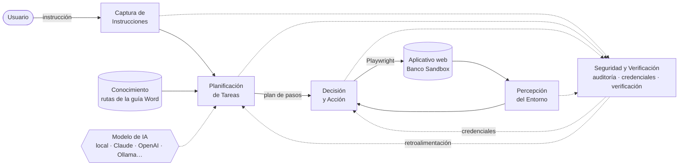

# Agente autónomo por voz para aplicativos web

Prototipo académico de un **agente de interfaz gráfica (GUI Agent)** que ejecuta tareas completas sobre un aplicativo web a partir de una sola instrucción de voz en español. Por ejemplo, «envía cien mil pesos a mi hijo» se convierte en los diez pasos de una transferencia: navegar, elegir la cuenta, escribir la llave, consultar, escribir el monto, continuar, ingresar la clave dinámica y confirmar.

El agente **aprende las rutas de una guía de procedimientos en Word**, permite **elegir el modelo de IA** que planifica (local, Claude, OpenAI, Gemini, Groq u Ollama) e incluye un **evaluador** para compararlos. La arquitectura se basa en el framework de Wang et al. (2025), con un módulo transversal de **Seguridad y Verificación**. Se evalúa sobre **Banco Sandbox**, un aplicativo bancario simulado incluido en este repositorio.

> ⚠️ **Proyecto académico.** El agente está diseñado para operar solo sobre el entorno simulado incluido. No lo uses con aplicativos bancarios reales ni con credenciales reales.

## Arquitectura



| Módulo | Carpeta | Qué hace | Equivalente en Wang et al. |
|---|---|---|---|
| Captura de Instrucciones | `captura/` | Voz (faster-whisper) o texto | Entrada del usuario |
| Percepción del Entorno | `percepcion/` | Lee campos, listas, botones y datos de la pantalla | GUI Perceiver |
| Planificación de Tareas | `planificacion/` | Instrucción → ruta + parámetros → plan de pasos | Task Planner |
| Decisión y Acción | `decision_accion/` | Ejecuta cada paso: elegir elemento, actuar, verificar | Decision Maker + Executor |
| Seguridad y Verificación | `seguridad/` | Auditoría, billetera de credenciales, verificación | Reemplaza al Memory Retriever |
| Conocimiento | `conocimiento/` | Rutas aprendidas de la guía Word | Memoria externa (construcción manual) |
| Modelos de IA | `ia/` | Proveedores intercambiables con una interfaz común | Modelo base (M)LLM |

### Dos modos de operación

- **Modo tarea** (nuevo): la instrucción corresponde a una ruta de la guía. La IA identifica la ruta y extrae los datos; el agente pregunta lo que falte y ejecuta todos los pasos, verificando cada uno.
- **Modo paso a paso** (versión 1): para comandos cortos que coinciden con un elemento visible («continuar», «consultar») o instrucciones que no corresponden a ninguna ruta.

La IA **no improvisa clics**: solo elige entre las rutas de la guía y entre los elementos visibles. La ejecución sigue los pasos de la guía, y las credenciales nunca llegan al modelo de IA.

## Estructura del repositorio

```
agente-autonomo-voz/
├── main.py                  Punto de entrada: integra todos los módulos
├── configuracion.py         Ajustes: URL, umbrales, rutas y modelos de IA
├── captura/                 captura.py (voz o texto) · voz.py (faster-whisper)
├── percepcion/              percepcion.py: estado de la interfaz
├── planificacion/           planificador.py (tareas) · comandos.py (pasos sueltos)
├── decision_accion/         ejecutor.py (planes) · acciones.py · paso_a_paso.py
├── seguridad/               Auditoría, billetera, biometría y verificación (ver su README)
├── conocimiento/            lector_word.py · memoria.py · rutas/ (memoria aprendida)
├── ia/                      local.py · anthropic.py · openai_compatible.py · extraccion.py
├── evaluacion/              Comparación de modelos: casos.json y resultados/
├── comun/                   Utilidades: texto y números en español
├── guias/                   Guia_Banco_Sandbox.docx (documento de entrenamiento)
├── sandbox/                 Banco Sandbox: aplicativo bancario simulado
└── requirements.txt
```

No se versionan (ver `.gitignore`): `credenciales.wallet`, `auditoria/`, `modelos/` y `.env`.

## Instalación

Requiere Python 3.10 o superior.

```bash
python -m venv .venv
.venv\Scripts\activate            # Windows
source .venv/bin/activate         # macOS / Linux

pip install -r requirements.txt
playwright install chromium
```

## Uso rápido

**1. Levantar el aplicativo simulado** (en otra terminal):

```bash
python -m http.server 5173 -d sandbox
```

**2. Crear la billetera de credenciales** (una sola vez):

```bash
python -m seguridad crear
python -m seguridad agregar --app banco_sandbox --nombre "Banco Sandbox" --origen http://localhost:5173
```

Credenciales del sandbox: usuario `demo.usuario`, clave `Sandbox2026` y un secreto adicional `clave_dinamica` con valor `123456`.

**3. Entrenar al agente con la guía** (y cada vez que la modifiques):

```bash
python -m conocimiento entrenar guias/Guia_Banco_Sandbox.docx
```

**4. Ejecutar:**

```bash
python main.py                      # voz + IA local
python main.py --entrada texto      # escribir las instrucciones (pruebas)
python main.py --ia claude          # planificar con Claude
```

Ejemplos de instrucciones:

| Instrucción | Qué hace el agente |
|---|---|
| «¿Cuánto dinero tengo en la cuenta de ahorros?» | Si no hay sesión, ingresa con la billetera; luego lee el saldo |
| «Transfiere ciento cincuenta mil pesos a Lucía» | Transferencia completa; pide confirmación antes de enviar |
| «Manda cien mil a mi hijo» | Resuelve «mi hijo» con los contactos de la guía (@marco) |
| «Quiero enviar dinero» | Pregunta a quién y cuánto antes de empezar |
| «Dime el penúltimo movimiento» | Abre los movimientos y lee el segundo |
| «Necesito el certificado tributario 2024 de la cuenta corriente» | Elige producto, tipo y año, genera el certificado y lee el folio |
| «Continuar», «consultar» | Paso suelto sobre la pantalla actual (modo paso a paso) |
| «Salir» | Apaga el agente («cerrar sesión» cierra la sesión del banco) |

## Entrenamiento con guías Word

La guía es un documento Word con un formato sencillo. El agente lo lee y genera una memoria de rutas en `conocimiento/rutas/` (JSON legible).

- **Encabezado:** párrafos `Aplicativo:` y `Origen:` (la URL del aplicativo).
- **Contactos:** tabla `Nombre | Alias | Llave`, para entender «a mi hijo» o «a Lucía».
- **Procedimientos:** un título `Procedimiento: <nombre>` con identificador, descripción, frases de ejemplo y dos tablas:
  - **Parámetros:** `Parámetro | Tipo | Obligatorio | Valores permitidos | Por defecto | Pregunta al usuario | Pista`. Tipos: `llave`, `monto`, `opcion`, `anio` y `texto`.
  - **Pasos:** `# | Acción | Elemento | Valor | Confirmar | Resultado esperado`. Acciones: `ir_a`, `clic`, `escribir`, `seleccionar`, `leer` y `esperar`.

Los valores entre llaves se reemplazan al ejecutar: `{monto}` por el parámetro y `{credencial:clave}` por el secreto de la billetera, en el último momento. La primera sección de `guias/Guia_Banco_Sandbox.docx` explica el formato con ejemplos.

```bash
python -m conocimiento entrenar guias/<guia>.docx   # valida y guarda la memoria
python -m conocimiento listar                        # rutas aprendidas
python -m conocimiento ver transferencia_breb        # pasos de una ruta
```

El entrenamiento valida la guía como un compilador: rechaza acciones desconocidas, parámetros no declarados, tipos inválidos o identificadores repetidos, e indica el procedimiento y el paso con el problema.

## Modelos de IA

| Nombre | Tipo | Requiere |
|---|---|---|
| `local` | Embeddings + reglas, sin internet | Nada (por defecto) |
| `claude`, `claude-sonnet` | API de Anthropic | `ANTHROPIC_API_KEY` |
| `openai` | API de OpenAI | `OPENAI_API_KEY` |
| `gemini` | API de Google (formato OpenAI) | `GEMINI_API_KEY` |
| `groq` | API de Groq (formato OpenAI) | `GROQ_API_KEY` |
| `ollama` | Modelos locales (Llama, Qwen, Mistral…) | [Ollama](https://ollama.com) instalado |

Las llaves van en variables de entorno o en un archivo `.env` en la raíz (excluido de git):

```
ANTHROPIC_API_KEY=...
OPENAI_API_KEY=...
```

```bash
python main.py --ia claude
python main.py --ia ollama --modelo llama3.1:8b
```

Los nombres de modelo cambian con el tiempo: consulta los vigentes con `python -m evaluacion --listar-modelos <proveedor>` y úsalos con `--ia proveedor@modelo` (por ejemplo `--ia ollama@llama3.1:8b`). Para agregar otro proveedor con API compatible con OpenAI basta con una entrada nueva en `PROVEEDORES_IA`.

Con `GROUNDING = "ia"` en `configuracion.py`, el modelo de IA también elige el elemento de pantalla de cada paso; por defecto lo hace la similitud semántica local, que es más rápida y no tiene costo.

**Privacidad:** a los modelos externos solo se envían la instrucción, el catálogo de rutas (sin pasos) y los contactos de la guía. Nunca credenciales ni el contenido de la pantalla, salvo las etiquetas de los elementos cuando `GROUNDING = "ia"`.

## Evaluación de modelos

La ejecución de los pasos es determinística (sigue la guía), así que la diferencia entre modelos está en la **planificación**: identificar la ruta correcta y extraer bien los datos. El evaluador mide exactamente eso, sin abrir el navegador.

```bash
python -m evaluacion --listar-modelos claude openai gemini groq ollama   # modelos vigentes
python -m evaluacion --ia local claude ollama@qwen2.5:7b ollama@llama3.1:8b
python -m evaluacion --ia claude --repeticiones 3 --pausa 1              # estabilidad
```

Los casos de `evaluacion/casos.json` (37 instrucciones) están en seis categorías: directa, coloquial, por contacto, dictado por voz, incompleta y fuera de dominio. Ninguna coincide con las frases de ejemplo de la guía; el evaluador lo verifica y advierte si se agrega un caso que coincida, porque eso inflaría el resultado del modelo local.

| Métrica | Significado |
|---|---|
| Acierto de ruta | Ruta correcta, o ninguna cuando la instrucción no corresponde a ninguna |
| Exactitud de datos | Parámetros esperados extraídos con el valor correcto |
| Casos completos | Ruta y todos los parámetros correctos |
| Latencia | Mediana, media y máximo por instrucción |
| Tokens | Entrada y salida (modelos LLM), para estimar costos |

Resultados en `evaluacion/resultados/`, con separador `;` para Excel en español: `_resumen.csv` (por modelo), `_por_categoria.csv`, `_detalle.csv` (cada caso) y `_metadatos.json` (modelos, versión de la guía, casos y umbrales usados, para reproducir la corrida).

## Seguridad

- **Credenciales fuera de la IA.** Los planes llevan referencias `{credencial:…}` que resuelve la billetera cifrada en el momento de escribir.
- **Reglas que no dependen de la guía:** un campo sensible solo se llena desde la billetera, y un secreto solo se escribe en un campo sensible. Si una guía mal escrita lo intenta, el paso se bloquea y queda en la auditoría.
- **Confirmación humana** en los pasos marcados con `Confirmar = Sí`, como enviar dinero.
- **Ingreso automático controlado:** si una tarea encuentra la pantalla de ingreso, el agente ejecuta la ruta «ingresar» (con la clave maestra) y reintenta el paso una sola vez.
- **Auditoría** de cada módulo con cadena de hashes, capturas con campos sensibles tapados y resumen de tareas exitosas y fallidas. Detalles en [`seguridad/README.md`](seguridad/README.md).

## Limitaciones

- Prueba de concepto sobre un entorno simulado y controlado.
- El agente solo ejecuta tareas descritas en la guía; para tareas nuevas hay que agregar su procedimiento.
- La percepción usa el DOM (etiquetas, `placeholder`, `aria-label`), no visión por computador.
- El porcentaje de confianza es una similitud o una estimación del modelo, no una probabilidad calibrada.
- La extracción por reglas del proveedor local cubre los tipos de parámetro definidos; los modelos LLM generalizan mejor en textos libres.
- La verificación facial no incluye detección de vida.

## Referencias

- S. Wang et al., "GUI Agents with Foundation Models: A Comprehensive Survey," arXiv:2411.04890, 2025.
- N. Reimers and I. Gurevych, "Sentence-BERT: Sentence Embeddings using Siamese BERT-Networks," in *Proc. EMNLP-IJCNLP*, 2019.
- OpenCV Zoo: modelos YuNet (detección facial) y SFace (reconocimiento facial).

## Autor

Trabajo de grado. Autor: _tu nombre_ · Director: _nombre del director_ · _Universidad_, 2026.
