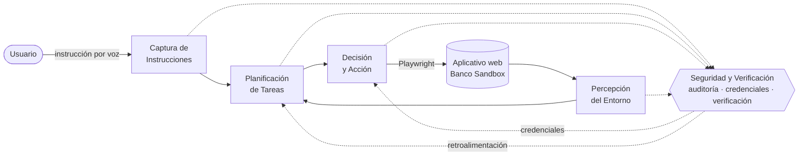

# Agente autónomo por voz para aplicativos web

Prototipo académico de un **agente de interfaz gráfica (GUI Agent)** que ejecuta tareas sobre un aplicativo web a partir de instrucciones de voz en español, sin que el usuario necesite conocer la estructura de la interfaz ni los pasos de navegación.

La arquitectura se basa en el framework unificado de Wang et al. (2025) y lo adapta con un módulo transversal de **Seguridad y Verificación** (auditoría, gestión de credenciales y verificación de cada acción). El agente se evalúa sobre **Banco Sandbox**, un aplicativo bancario simulado incluido en este repositorio.

> ⚠️ **Proyecto académico.** El agente está diseñado para operar solo sobre el entorno simulado incluido. No lo uses con aplicativos bancarios reales ni con credenciales reales.

## Arquitectura



| Módulo | Implementación | Equivalente en Wang et al. |
|---|---|---|
| Captura de Instrucciones | `voz.py`, `capturar()`, `limpiar_dictado()` | Entrada del usuario |
| Percepción del Entorno | `percibir()`: Playwright lee campos, botones y enlaces | GUI Perceiver |
| Planificación de Tareas | `planificar()`: intención ESCRIBIR, CLIC, AUTENTICAR o SALIR | Task Planner |
| Decisión y Acción | `mejor_match()` con embeddings multilingües + `ejecutar_escritura()` / `ejecutar_clic()` | Decision Maker + Executor |
| Seguridad y Verificación | paquete `seguridad/` | Reemplaza al Memory Retriever |

Cada comando de voz recorre el ciclo **captura → planificación → decisión y acción → verificación → percepción**, y cada módulo deja registro en la auditoría.

## Estructura del repositorio

```
agente-autonomo-voz/
├── agente_voz.py          Orquestador: captura, percepción, planificación, decisión y acción
├── voz.py                 Reconocimiento de voz (ver nota en Instalación)
├── seguridad/             Módulo de Seguridad y Verificación
│   ├── __init__.py        Fachada: ModuloSeguridadVerificacion
│   ├── __main__.py        Herramientas: python -m seguridad ...
│   ├── auditoria.py       Log JSONL con marca de tiempo, encadenado por hash SHA-256
│   ├── billetera.py       Credenciales cifradas por aplicativo (PBKDF2 + Fernet)
│   ├── biometria.py       Verificación facial opcional (OpenCV YuNet + SFace)
│   └── verificacion.py    Postcondiciones de cada acción y lectura de errores
├── sandbox/               Banco Sandbox: aplicativo bancario simulado (HTML/JS)
└── requirements.txt
```

Se generan localmente y **no se versionan** (ver `.gitignore`): `credenciales.wallet`, `auditoria/` y `modelos/`.

## Instalación

Requiere Python 3.10 o superior.

```bash
python -m venv .venv
.venv\Scripts\activate            # Windows
source .venv/bin/activate         # macOS / Linux

pip install -r requirements.txt
playwright install chromium
```

`voz.py` debe estar en la raíz del proyecto y exponer la función `escuchar(modo="enter")`, que devuelve el texto reconocido. Agrega sus dependencias a `requirements.txt`.

## Uso

**1. Levantar el aplicativo simulado** (en una terminal aparte):

```bash
python -m http.server 5173 -d sandbox
```

**2. Crear la billetera de credenciales** (una sola vez):

```bash
python -m seguridad crear
python -m seguridad agregar --app banco_sandbox --nombre "Banco Sandbox" --origen http://localhost:5173
python -m seguridad listar
```

Con `agregar`, ingresa las credenciales de prueba del sandbox: usuario `demo.usuario`, clave `Sandbox2026` y un secreto adicional llamado `clave_dinamica` con valor `123456`.

**3. Ejecutar el agente:**

```bash
python agente_voz.py
```

Ejemplo de tarea completa (transferencia Bre-B), dicha comando por comando:

| Comando de voz | Resultado |
|---|---|
| "usar mis credenciales" | Pide la clave maestra por teclado e inicia sesión con la billetera |
| "enviar dinero" | Abre el formulario de envío |
| "llave" → "arroba lucía" | Escribe `@lucia` |
| "consultar" | Muestra el titular de la llave |
| "monto" → "ciento cincuenta mil" | Escribe `150000` |
| "continuar" | Pasa a la confirmación |
| "clave dinámica" | La toma de la billetera, sin dictarla |
| "enviar dinero" | Muestra el comprobante |
| "salir" | Cierra la sesión del agente y la auditoría |

## Seguridad

- **Credenciales fuera del razonamiento del agente.** Los campos sensibles (clave, clave dinámica, PIN) nunca se dictan por voz: el agente los detecta y toma el valor de la billetera, que lo entrega directamente al campo.
- **Billetera cifrada.** La llave de cifrado se deriva de una clave maestra con PBKDF2-HMAC-SHA256 (600.000 iteraciones). La clave maestra se pide por teclado y no se almacena.
- **Credenciales ligadas al origen.** Cada credencial solo se entrega al sitio registrado (esquema, host y puerto).
- **Control de acceso.** Bloqueo temporal tras 3 intentos fallidos y re-bloqueo automático tras 5 minutos de inactividad.
- **Verificación facial opcional.** Con `AUTENTICACION_FACIAL = True` en `agente_voz.py` se exige el rostro antes de entregar cada clave. Para registrarlo: `python -m seguridad enrolar-rostro`.

## Auditoría y evidencia

Cada ejecución crea `auditoria/<AAAAMMDD_HHMMSS_id>/` con:

- `auditoria.log`: registro legible de cada evento, por módulo y paso.
- `auditoria.jsonl`: registro estructurado; cada línea incluye el hash de la anterior.
- `capturas/`: una captura por paso, con los campos sensibles ocultos.

```bash
python -m seguridad verificar auditoria/<sesion>   # detecta ediciones o líneas borradas
python -m seguridad csv       auditoria/<sesion>   # exporta a CSV (separador ';' para Excel)
```

Los secretos nunca se escriben en el registro: se reemplazan por `••••••`.

## Limitaciones

- Prueba de concepto sobre un entorno simulado y controlado; no se valida con aplicativos reales.
- La percepción usa los atributos del DOM (etiquetas, `placeholder`, `aria-label`), no visión por computador.
- El porcentaje de confianza es la similitud coseno × 100, no una probabilidad.
- La verificación facial no incluye detección de vida: una fotografía podría engañarla.
- Mientras la billetera está desbloqueada, los secretos residen en la memoria del proceso.

## Referencias

- S. Wang et al., "GUI Agents with Foundation Models: A Comprehensive Survey," arXiv:2411.04890, 2025.
- N. Reimers and I. Gurevych, "Sentence-BERT: Sentence Embeddings using Siamese BERT-Networks," in *Proc. EMNLP-IJCNLP*, 2019.
- OpenCV Zoo: modelos YuNet (detección facial) y SFace (reconocimiento facial).

## Autor

Trabajo de grado. Autor: _tu nombre_ · Director: _nombre del director_ · _Universidad_, 2026.
