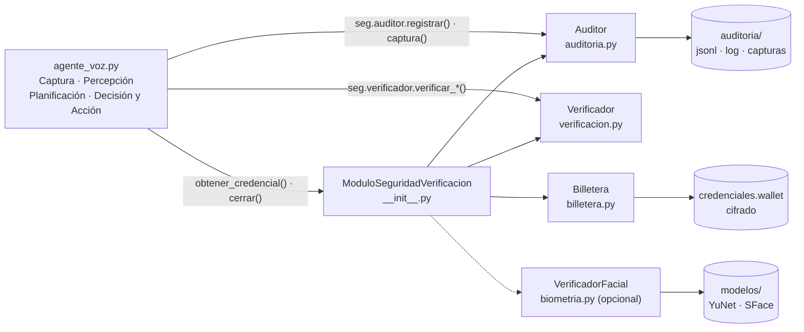
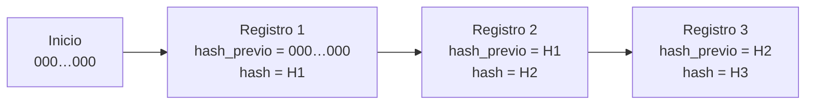
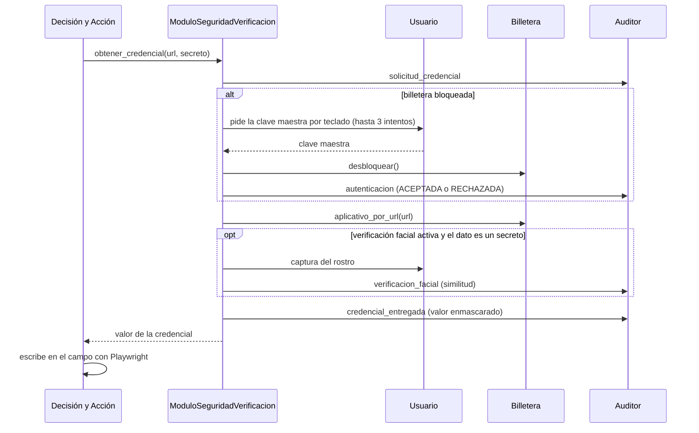

# Módulo de Seguridad y Verificación

Componente **transversal** del agente autónomo por voz. Acompaña a los demás módulos (Captura, Percepción, Planificación y Decisión y Acción) durante todo el ciclo de ejecución y asume tres responsabilidades:

| Responsabilidad | Qué hace | Archivo |
|---|---|---|
| **Auditoría** | Registra con fecha y hora cada evento de cada módulo, en un log encadenado por hash que detecta manipulaciones. | `auditoria.py` |
| **Credenciales** | Guarda las credenciales cifradas por aplicativo y las entrega directamente al campo, sin pasar por la voz ni por el razonamiento del agente. | `billetera.py`, `biometria.py` |
| **Verificación** | Comprueba el efecto de cada acción sobre la interfaz y lee los mensajes de error o éxito de la aplicación. | `verificacion.py` |

En el framework de referencia de Wang et al. (2025), este módulo **reemplaza al Memory Retriever**: conserva la memoria interna del agente (acciones, capturas y estados) y añade validación, trazabilidad y gestión de credenciales.

---

## Contenido de la carpeta

```
seguridad/
├── __init__.py       Fachada: ModuloSeguridadVerificacion (punto de entrada único)
├── __main__.py       Herramientas de línea de comandos: python -m seguridad ...
├── auditoria.py      Auditor: log JSONL con marca de tiempo y cadena de hashes SHA-256
├── billetera.py      Billetera: credenciales cifradas (PBKDF2 + Fernet) ligadas al origen
├── biometria.py      VerificadorFacial: segundo factor opcional (OpenCV YuNet + SFace)
├── verificacion.py   Verificador: postcondiciones de escritura y clic
└── README.md         Este documento
```

Dependencias: `cryptography` (billetera), `playwright` (capturas y verificación), y opcionalmente `opencv-python` y `numpy` (biometría).

---

## Arquitectura

El agente crea una sola instancia de `ModuloSeguridadVerificacion`, que compone las tres responsabilidades. Los módulos del agente usan el auditor y el verificador a través de ella, y piden credenciales solo con `obtener_credencial()`.



### Lugar en el ciclo del agente

Cada comando de voz es un **paso**. En cada paso, el módulo interviene así:

| Etapa del agente | Intervención del módulo |
|---|---|
| Captura | Registra el texto reconocido, su duración y, si aplica, la versión normalizada. |
| Percepción | Registra el estado de la interfaz y guarda una captura con los campos sensibles tapados. |
| Planificación | Registra la intención detectada y la regla que la produjo. |
| Decisión y Acción | Registra el elemento elegido con su confianza; si el campo es sensible, entrega la credencial desde la billetera. |
| Después de la acción | Verifica el resultado y, si falla, registra la retroalimentación para el planificador. |

---

## Uso desde el código

```python
from seguridad import ModuloSeguridadVerificacion

seg = ModuloSeguridadVerificacion(
    ruta_billetera="credenciales.wallet",
    carpeta_auditoria="auditoria",
    autenticacion_facial=False,
)

seg.auditor.nuevo_paso()
seg.auditor.registrar("CAPTURA", "texto_capturado", texto="llave", duracion_s=3.1)

antes = seg.verificador.estado_pagina(page)          # instantánea previa
boton.click()
resultado = seg.verificador.verificar_clic(page, antes)   # OK / FALLO / SIN_EFECTO

clave = seg.obtener_credencial(page.url, "clave")    # None si se niega
campo.fill(clave)
resultado = seg.verificador.verificar_escritura(campo, clave, sensible=True)

seg.cerrar()   # bloquea la billetera, cierra la auditoría y verifica la cadena
```

### Parámetros de `ModuloSeguridadVerificacion`

| Parámetro | Valor por defecto | Descripción |
|---|---|---|
| `ruta_billetera` | `credenciales.wallet` en la carpeta del proyecto | Archivo cifrado de credenciales. |
| `carpeta_auditoria` | `auditoria` (relativa a la carpeta actual) | Carpeta de los logs. `agente_voz.py` pasa una ruta junto al script. |
| `autenticacion_facial` | `False` | Exige verificación facial antes de entregar cada secreto. |
| `minutos_desbloqueo` | `5` | Minutos sin uso tras los cuales la billetera se vuelve a bloquear. |
| `max_intentos` | `3` | Intentos de clave maestra antes del bloqueo temporal. |
| `minutos_bloqueo` | `2` | Duración del bloqueo tras agotar los intentos. |
| `guardar_capturas` | `True` | Guarda una captura de pantalla por cada percepción. |

---

## 1. Auditoría (`auditoria.py`)

### Archivos por sesión

Cada ejecución del agente crea una carpeta con un identificador único (`AAAAMMDD_HHMMSS_xxxxxx`):

```
auditoria/20261015_120915_a3f9c1/
├── auditoria.jsonl    registro estructurado: un evento JSON por línea
├── auditoria.log      la misma información en formato legible
└── capturas/          paso01_002_percepcion.png, paso03_005_percepcion.png, ...
```

### Formato de un registro

Ejemplo de la escritura de una clave tomada de la billetera:

```json
{
  "ts": "2026-10-15T12:09:46.392-05:00",
  "t_rel_s": 41.207,
  "sesion": "20261015_120915_a3f9c1",
  "paso": 1,
  "modulo": "DECISION_ACCION",
  "evento": "accion",
  "nivel": "INFO",
  "datos": {
    "tipo": "escribir",
    "campo": "•••••••• clave clave password Clave",
    "texto": "••••••",
    "origen_texto": "billetera",
    "exito": true
  },
  "hash_previo": "076f0c6dd4469166266981f667ffa37f3bdd0237146ab3d50e3dc16570098a7c",
  "hash": "f9b1e899e26a0e00fda312727735dfeb32d11e4c2e11da8d312025c8f5c648d3"
}
```

Los `••••••••` de `campo` son el *placeholder* del campo en la página; los `••••••` de `texto` son el enmascaramiento del valor real.

| Campo | Significado |
|---|---|
| `ts` | Fecha y hora ISO 8601 con milisegundos y zona horaria local. |
| `t_rel_s` | Segundos desde el inicio de la sesión (útil para medir tiempos de tarea). |
| `sesion` | Identificador de la ejecución. |
| `paso` | Número de comando de voz (0 = antes del primer comando). |
| `modulo` | `CAPTURA`, `PERCEPCION`, `PLANIFICACION`, `DECISION_ACCION`, `SEGURIDAD`, `VERIFICACION` o `SISTEMA`. |
| `evento` | Qué ocurrió (ver catálogo). |
| `nivel` | `INFO`, `WARN` o `ERROR`. |
| `datos` | Detalle del evento, con los secretos ya enmascarados. |
| `hash_previo`, `hash` | Eslabones de la cadena de integridad. |

La versión legible (`auditoria.log` y consola) tiene una línea por evento:

```
2026-10-15 12:09:46.392 | paso 01 | INFO  | DECISION_ACCION | accion | tipo=escribir | texto=•••••• | origen_texto=billetera | exito=True
```

### Cadena de integridad

Cada registro incluye el hash SHA-256 del registro anterior. El hash de cada registro se calcula sobre todos sus campos, excepto el propio `hash`, serializados en JSON con claves ordenadas. El primer registro se encadena a un valor inicial de 64 ceros.



`verificar_integridad()` recorre el archivo y detecta dos tipos de alteración:

- **Contenido modificado:** el hash recalculado de una línea no coincide con su campo `hash`.
- **Eslabón faltante o reordenado:** el `hash_previo` de una línea no coincide con el `hash` de la anterior (por ejemplo, si se borró una línea intermedia).

### Enmascaramiento de secretos

El auditor mantiene una lista de valores protegidos y reemplaza cualquier aparición por `••••••` en todos los datos antes de escribirlos, incluso en textos anidados. Es una defensa en profundidad: aunque un módulo intentara registrar una clave por error, no llegaría al disco.

- Al desbloquear la billetera, el módulo protege automáticamente todos sus secretos (excepto los identificadores, como el usuario).
- Cada credencial entregada se vuelve a proteger con `proteger()`.
- Las capturas de pantalla tapan los campos sensibles con un recuadro gris oscuro (`mask` de Playwright).

### Catálogo de eventos

| Módulo | Eventos | Datos principales |
|---|---|---|
| `SISTEMA` | `inicio_sesion`, `fin_sesion`, `interrupcion`, `error_inesperado`, `captura_fallida` | URL, modelo y umbral; resumen final con contadores y duración. |
| `CAPTURA` | `texto_capturado`, `captura_vacia`, `texto_normalizado`, `error_captura` | Texto reconocido, propósito (comando o texto a escribir), duración; original y normalizado. |
| `PERCEPCION` | `estado_interfaz` | URL, título, campos (marcando los sensibles), botones y ruta de la captura. |
| `PLANIFICACION` | `intencion`, `subtareas` | Comando, intención (`ESCRIBIR`, `CLIC`, `AUTENTICAR`, `SALIR`), regla y similitudes en %. |
| `DECISION_ACCION` | `decision`, `accion` | Elemento elegido, similitud, `confianza_pct`, umbral, aceptado; tipo de acción, texto (enmascarado si es secreto) y éxito. |
| `SEGURIDAD` | `campo_sensible`, `solicitud_credencial`, `autenticacion`, `credencial_entregada`, `credencial_denegada`, `acceso_bloqueado`, `billetera_bloqueada`, `billetera_inexistente`, `verificacion_facial` | Origen, nombre del secreto (nunca el valor), método y resultado de autenticación, intentos, similitud facial. |
| `VERIFICACION` | `verificacion`, `retroalimentacion` | Resultado (`OK`, `FALLO`, `SIN_EFECTO`), criterio, cambios de URL y contenido, mensajes de la app; motivo del fallo. |

### Resumen de cierre

`cerrar()` registra el evento `fin_sesion` con estos contadores y luego verifica la cadena completa:

`eventos`, `acciones_ok`, `acciones_fallidas`, `verificaciones_ok`, `verificaciones_fallidas`, `alertas_seguridad`, `pasos`, `duracion_s`.

---

## 2. Credenciales (`billetera.py` y `biometria.py`)

### Cifrado de la billetera

| Elemento | Implementación |
|---|---|
| Derivación de llave | PBKDF2-HMAC-SHA256, 600.000 iteraciones, sal aleatoria de 16 bytes. |
| Cifrado | Fernet (AES-128 en modo CBC con autenticación HMAC-SHA256). |
| Clave maestra | Se pide por teclado (`getpass`), nunca por voz, y **no se guarda en ningún lugar**. |
| Escritura | Atómica (archivo temporal + reemplazo) y con permisos `600` en sistemas Unix. |

Si la clave maestra es incorrecta, el descifrado falla por la verificación HMAC de Fernet y el acceso se rechaza.

Contenedor en disco (`credenciales.wallet`):

```json
{
  "formato": "agente-billetera/1",
  "kdf": "PBKDF2-HMAC-SHA256",
  "iteraciones": 600000,
  "sal": "base64…",
  "cifrado": "Fernet",
  "datos": "gAAAAA…"
}
```

Contenido una vez descifrado (solo existe en memoria):

```json
{
  "version": 1,
  "aplicativos": {
    "banco_sandbox": {
      "nombre": "Banco Sandbox",
      "origen": "http://localhost:5173",
      "secretos": { "usuario": "…", "clave": "…", "clave_dinamica": "…" }
    }
  },
  "biometria": null
}
```

### Credenciales ligadas al origen

Cada aplicativo se registra con su **origen** normalizado (esquema, host y puerto). El agente pide la credencial con la URL de la página actual, y la billetera solo la entrega si el origen coincide. Así, una credencial nunca se escribe en un sitio distinto al registrado, aunque la interfaz se parezca.

```
http://127.0.0.1:5173/login.html?x=1   →   http://localhost:5173
https://banco.co/a                     →   https://banco.co:443
```

### Identificadores y secretos

Los datos de la billetera se tratan de dos formas:

- **Identificadores** (`usuario`): se registran en claro, porque la auditoría debe poder decir *quién* ingresó, y no exigen verificación facial.
- **Secretos** (todo lo demás: `clave`, `clave_dinamica`, etc.): se enmascaran siempre y, si está activa, exigen verificación facial.

### Flujo de entrega de una credencial



Si cualquier paso falla (billetera inexistente, origen no registrado, secreto ausente, autenticación o rostro rechazados), `obtener_credencial()` devuelve `None`, registra el motivo y el agente no escribe nada.

### Políticas de acceso

| Política | Comportamiento |
|---|---|
| Desbloqueo bajo demanda | La clave maestra se pide solo cuando se necesita la primera credencial, no al iniciar el agente. |
| Intentos limitados | Tras 3 intentos fallidos, el acceso queda bloqueado 2 minutos (`acceso_bloqueado`). |
| Re-bloqueo por inactividad | Si pasan 5 minutos sin usar la billetera, se bloquea; se comprueba en la siguiente solicitud. |
| Campos sensibles | El agente detecta los campos de clave, clave dinámica, PIN u OTP y nunca pide dictarlos; toma el valor de la billetera. |
| Cierre | Al terminar la sesión, la billetera se bloquea y se descarta su contenido descifrado. |

### Verificación facial opcional

`VerificadorFacial` usa dos modelos de OpenCV Zoo que se descargan una sola vez en `modelos/` (unos 40 MB):

- **YuNet** detecta el rostro en la imagen de la cámara. Solo se acepta un fotograma con **exactamente un** rostro.
- **SFace** convierte el rostro en un vector de 128 dimensiones.

| Operación | Detalle |
|---|---|
| Enrolamiento | Toma 5 muestras en un máximo de 30 s y las guarda **cifradas dentro de la billetera**. |
| Verificación | Toma 3 muestras en un máximo de 12 s y compara cada una con las de referencia por similitud coseno. |
| Decisión | Se acepta si la mejor similitud es al menos **0.363**, el umbral recomendado por OpenCV para SFace. |

La verificación facial actúa como **segundo factor de presencia**: no reemplaza a la clave maestra, que sigue siendo la que descifra la billetera.

---

## 3. Verificación (`verificacion.py`)

### Verificación de escritura

Después de escribir en un campo, lee su valor real con `input_value()` y lo compara con el texto esperado:

| Resultado | Condición |
|---|---|
| `OK` | El valor coincide exactamente. |
| `OK` con nota | El valor coincide al ignorar espacios, puntos, comas y `$` (la app reformateó, por ejemplo `150.000` → `150000`). |
| `FALLO` | El valor no quedó escrito o la app lo recortó o transformó. |

Si el campo es sensible, el valor leído se registra enmascarado.

### Verificación de clic

Antes del clic se toma una instantánea de la página: URL, título, una huella SHA-1 del texto visible y los errores ya visibles. Después del clic (y de esperar a que la página cargue) se toma otra y se leen los mensajes de la aplicación:

| Tipo de mensaje | Cómo se reconoce |
|---|---|
| Error | Elementos con `role="alert"` o clase que contiene `error`. |
| Éxito | Clase, rol o `data-testid` que contiene `exito` o `success`. |
| Informativo | Otros elementos con `role="status"` o clase `alert`. |

| Resultado | Condición |
|---|---|
| `FALLO` | Aparecieron errores nuevos, o un error previo sigue visible y la pantalla no cambió. |
| `OK` | Cambió la URL, cambió el contenido o apareció un mensaje de éxito, sin errores nuevos. |
| `SIN_EFECTO` | No cambió nada. |

Distinguir errores **nuevos** de **persistentes** evita que un error de una acción anterior se atribuya al clic actual.

Cuando el resultado no es `OK`, el agente registra el evento `retroalimentacion` con el mensaje de la aplicación (por ejemplo, *"No encontramos esta llave"*) y se lo informa al usuario.

---

## 4. Herramientas de línea de comandos

Se ejecutan desde la carpeta del proyecto (la que contiene `seguridad/`):

| Comando | Función |
|---|---|
| `python -m seguridad crear` | Crea la billetera y define la clave maestra (mínimo 8 caracteres). |
| `python -m seguridad agregar --app ID --nombre "…" --origen URL` | Agrega o reemplaza un aplicativo; pide usuario, clave y secretos adicionales. |
| `python -m seguridad listar` | Lista aplicativos y nombres de secretos, sin mostrar valores. |
| `python -m seguridad eliminar --app ID` | Elimina un aplicativo. |
| `python -m seguridad enrolar-rostro` | Registra el rostro para la verificación facial. |
| `python -m seguridad verificar auditoria/<sesion>` | Comprueba la cadena de integridad de una sesión. |
| `python -m seguridad csv auditoria/<sesion>` | Exporta la sesión a CSV con separador `;` (compatible con Excel en español). |

Para usar un archivo distinto al predeterminado, pon `--billetera RUTA` **antes** del comando, por ejemplo `python -m seguridad --billetera pruebas.wallet crear`. Sirve para tener una billetera de pruebas con valores errados (casos de error de la evaluación); para que el agente la use, cambia `RUTA_BILLETERA` en `agente_voz.py`.

**Pruebas automatizadas:** si existe la variable de entorno `AGENTE_CLAVE_MAESTRA`, se usa su valor en lugar de pedir la clave por teclado. Úsala solo en pruebas, nunca con credenciales reales.

---

## 5. Archivos generados

| Archivo o carpeta | Contenido | ¿Versionar en git? |
|---|---|---|
| `credenciales.wallet` | Billetera cifrada | **No** |
| `auditoria/` | Logs y capturas (contienen la voz transcrita y datos de la sesión) | **No** |
| `modelos/` | Modelos faciales descargados | No (se descargan solos) |

El `.gitignore` del repositorio ya los excluye.

---

## 6. Limitaciones conocidas

Estas limitaciones son propias de un prototipo académico sobre un entorno simulado y conviene declararlas en el documento:

- **Cadena de integridad sin firma.** Detecta ediciones y líneas borradas en medio del archivo, pero no la eliminación de las **últimas** líneas, y alguien con acceso al archivo podría recalcular la cadena completa. Una sesión sin evento `fin_sesion` indica un cierre anormal o un recorte. Para una versión robusta habría que firmar los registros con una llave secreta o anclar el último hash en un sistema externo.
- **Enmascaramiento no retroactivo.** Los secretos se protegen desde que se desbloquea la billetera; un secreto dictado en voz alta antes de ese momento quedaría en claro.
- **Secretos en memoria.** Mientras la billetera está desbloqueada, su contenido descifrado reside en la memoria del proceso.
- **Biometría sin detección de vida.** Una fotografía del usuario podría superar la verificación facial.
- **Verificación heurística.** Se basa en cambios de URL, contenido y mensajes con roles o clases conocidas. Una pantalla de "sección no disponible" sin alerta se marcaría como `OK` porque cambió la URL.
- **Variable de entorno de pruebas.** Con `AGENTE_CLAVE_MAESTRA`, el log registra el método `clave_maestra` igual que si se hubiera escrito por teclado.

---

## Referencia

S. Wang et al., "GUI Agents with Foundation Models: A Comprehensive Survey," arXiv:2411.04890, 2025. El framework de cinco componentes de este trabajo (GUI Perceiver, Task Planner, Decision Maker, Memory Retriever y Executor) es la base de la arquitectura del agente.
